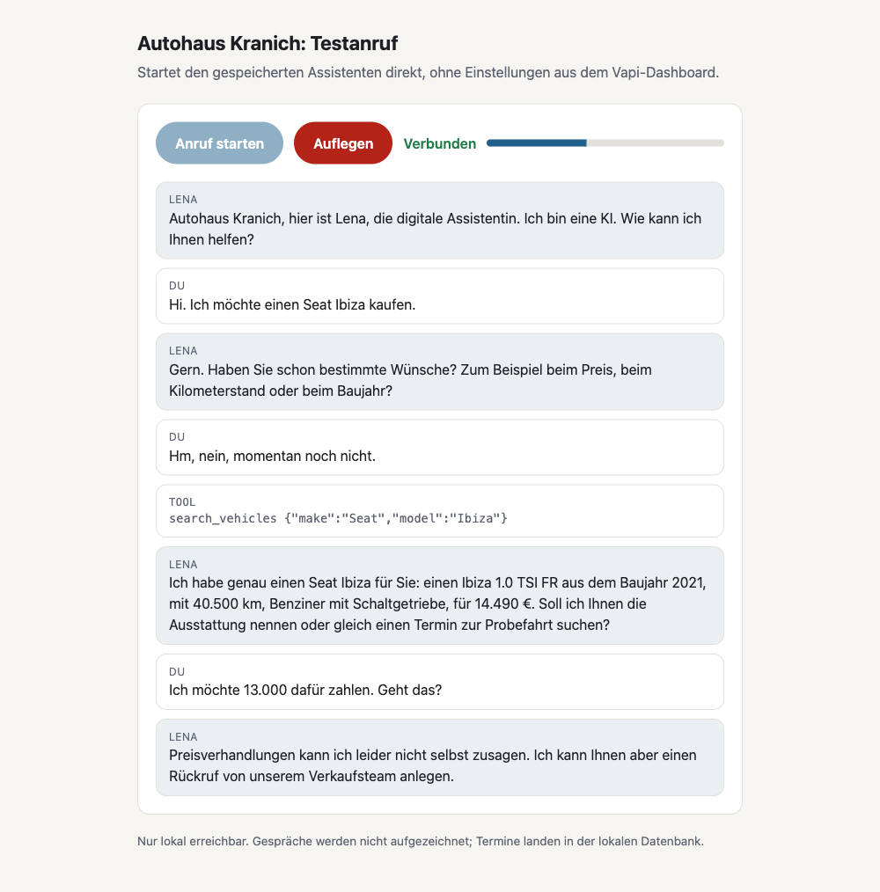
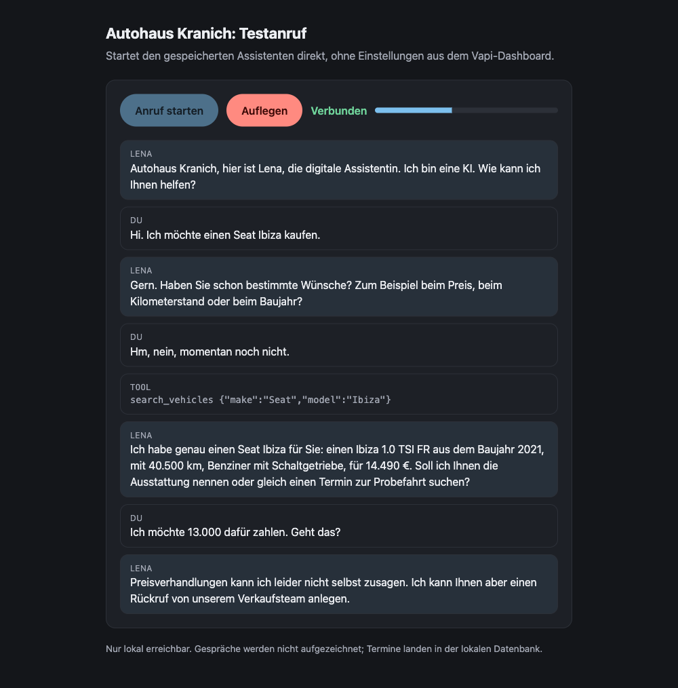
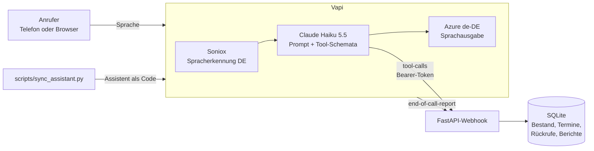

<div align="center">


# voice-agent-showcase 📞🚗

**Ein KI-Telefonassistent für ein Autohaus: sucht im Fahrzeugbestand, bucht Probefahrten und Werkstatttermine, sagt ab und legt Rückrufe an. Auf Deutsch, ohne Aufzeichnung, mit eigener Fachlogik statt Prompt-Magie.**

<sub>Das Autohaus Kranich, sein Bestand und alle Personen sind fiktiv. Das Projekt zeigt, wie ein produktionsnaher Voice Agent gebaut, abgesichert und getestet wird.</sub>

<p>
  <a href="https://www.paypal.com/donate/?business=martin.pfeffer@celox.io&item_name=voice-agent-showcase&currency_code=EUR">
    
  </a>
  <a href="https://g.page/r/CXgdRV3QysvxEBM/review">
    
  </a>
</p>

[](https://github.com/pepperonas/voice-agent-showcase/actions/workflows/ci.yml)
[](#tests)
[](.github/workflows/ci.yml)
[](LICENSE)
[](https://github.com/pepperonas/voice-agent-showcase/commits/main)
[](#projektstruktur)
[](https://github.com/pepperonas/voice-agent-showcase/stargazers)
[](https://github.com/pepperonas/voice-agent-showcase/pulls)

[](pyproject.toml)
[](app/main.py)
[](app/db.py)
[](uv.lock)
[](https://vapi.ai)
[](assistant/config.py)
[](assistant/config.py)
[](assistant/config.py)

[](#datenschutz)
[](assistant/config.py)
[](assistant/)
[](https://claude.com/claude-code)

</div>

---

## Inhalt

- [So klingt Lena](#so-klingt-lena)
- [Was Lena kann](#was-lena-kann)
- [Architektur](#architektur)
- [Entscheidungen aus echten Testanrufen](#entscheidungen-aus-echten-testanrufen)
- [Sicherheit](#sicherheit)
- [Datenschutz](#datenschutz)
- [Schnellstart](#schnellstart)
- [Konfiguration](#konfiguration)
- [Tests](#tests)
- [Projektstruktur](#projektstruktur)
- [Grenzen und nächste Schritte](#grenzen-und-nächste-schritte)

## So klingt Lena

Die lokale Testseite `/demo` startet den gespeicherten Assistenten direkt im Browser und zeigt das Gespräch live mit Transkript und Tool-Aufrufen. Der Verlauf unten ist nach einem echten Testanruf nachgestellt.

<p align="center">
  
  
</p>

## Was Lena kann

| Fähigkeit | Werkzeug | Was dahinter steckt |
|---|---|---|
| 🔎 Fahrzeuge finden | `search_vehicles` | Filter nach Marke, Modell, Preis, Kraftstoff, Karosserie, Kilometern, Baujahr. Höchstens drei Treffer, günstigste zuerst, damit niemand eine Liste vorgelesen bekommt. |
| 📋 Details nennen | `get_vehicle_details` | Ausstattung, Leistung, Farbe. Lena nennt nur, was das Werkzeug liefert, und erfindet nichts. |
| 📅 Freie Termine | `check_availability` | Probefahrt (45 min), Verkaufsberatung (30 min), Inspektion, Ölwechsel, Reifenwechsel, HU/AU, Klimaservice. Getrennte Öffnungszeiten für Verkauf und Werkstatt, zwei parallele Plätze. Ist der Wunschtag voll oder geschlossen, kommt der nächste freie Tag. |
| ✅ Buchen | `book_appointment` | Sechsstelliger Buchungscode, Ziffer für Ziffer gesprochen. Ein Fahrzeug wird nie doppelt zur Probefahrt gebucht. |
| ❌ Absagen | `cancel_appointment` | Nur mit Buchungscode und der bei der Buchung genannten Telefonnummer. |
| 📞 Rückruf | `request_callback` | Für Finanzierung, Inzahlungnahme, Preisverhandlung und alles, was eine KI nicht zusagen soll. |
| 🙋 Mensch | `transferCall` | Weiterleitung an das Team, sobald eine Nummer konfiguriert ist. |
| 📝 Anrufbericht | `end-of-call-report` | Deutsche Zusammenfassung fürs Team, die nur als erledigt zählt, was ein Werkzeug bestätigt hat. |

## Architektur



**Grundidee:** Das Sprachmodell führt das Gespräch, entscheidet aber nichts Verbindliches. Ob ein Termin frei ist, ob gebucht oder storniert werden darf, steht in getestetem Python-Code (`app/domain.py`, `app/tools.py`). Das Modell bekommt das Ergebnis als kurzes JSON zurück und formuliert es für den Anrufer.

**Assistent als Code:** Prompt, Tool-Schemata, Spracherkennung, Modell, Stimme und Zusammenfassung liegen versioniert in [`assistant/`](assistant/). `scripts/sync_assistant.py` legt den Assistenten und das Webhook-Credential über die Vapi-API an oder aktualisiert sie. Nichts muss im Dashboard zusammengeklickt werden, jede Änderung ist nachvollziehbar.

## Entscheidungen aus echten Testanrufen

Jeder Punkt hier ist aus einem konkreten Fehler in einem Testanruf entstanden, nicht aus der Theorie.

| Beobachtung | Ursache | Lösung |
|---|---|---|
| Preise wurden als „1 1 9 9 0 Euro“ gesprochen | Vapi formatiert Zahlen nach englischen Regeln und zerlegt alles ab 2025 in Einzelziffern | Nur sprachneutrale Formatierer; die deutsche Stimme liest „11.990 €“ selbst. Codes und Telefonnummern kommen gezielt als Einzelziffern. |
| „Seat“ wurde „Sieat“ ausgesprochen und erkannt | Englische Aussprache, fehlendes Fachvokabular | Aussprache-Ersetzungen (Seat, ID.3, HU/AU, TSI) und 48 Fachbegriffe als Vokabular für die Erkennung |
| Diktierte Angaben wurden abgeschnitten | Vapis Standardprofil beendet den Redebeitrag schon bei kurzen Pausen | Soniox mit geduldigerer Satzende-Erkennung; Deepgram als Rückfallebene |
| „Einen einen Moment. Moment.“ | Tool-Ansage und Prompt sagten es beide | Die Ansage kommt nur noch aus dem Werkzeug |
| Lena schwieg, der Anruf brach ab | Der Testknopf im Vapi-Dashboard schickt die Konfiguration des offenen Browser-Tabs mit, inklusive einer veralteten Server-Adresse | Eigene Testseite `/demo`, die den gespeicherten Assistenten startet |
| Bericht meldete „Rückruf vereinbart“, obwohl keiner angelegt war | Die Zusammenfassung verwechselte Angebot und Ergebnis | Als erledigt zählt nur, was ein Werkzeug bestätigt hat; alles andere steht als offen drin |

**Messwerte des letzten Testanrufs:** 1,26 s Antwortzeit pro Gesprächswechsel (vorher 1,7 s), Spracherkennung 338 ms, Modell 400 ms, Webhook 0,57 s inklusive Tunnel.

## Sicherheit

- **Webhook nur mit Bearer-Token.** Vergleich in konstanter Zeit, ein zu kurzer Token verhindert den Start. Bei Ablehnung protokolliert der Server den Grund, nie den Wert.
- **Wiederholte Tool-Aufrufe buchen nicht doppelt.** Buchungen und Rückrufe sind über die `toolCallId` idempotent.
- **Buchung prüft selbst.** Vorlaufzeit, 14-Tage-Horizont und 30-Minuten-Raster gelten auch dann, wenn jemand das Werkzeug direkt aufruft.
- **Missbrauchsgrenzen hängen an der Vapi-Anruf-ID, nicht an der Telefonnummer,** die der Anrufer selbst nennt. Sonst könnte ein Angreifer mit fremder Nummer einen echten Kunden aussperren. Höchstens drei Buchungen und drei Storno-Fehlversuche pro Anruf.
- **Kein Durchprobieren von Buchungscodes über viele Anrufe.** Ab zehn Fehlversuchen pro Nummer in 24 Stunden wird ein Storno nur noch angenommen, wenn die echte Anrufernummer passt; sonst übernimmt ein Mitarbeiter. Keine harte Sperre, damit niemand einen fremden Kunden blockieren kann.
- **Testseite nur lokal.** Über den öffentlichen Tunnel antwortet `/demo` mit 404, damit niemand Anrufe auf fremde Kosten startet. Der Private Key erscheint nie auf der Seite.
- **Keine Geheimnisse im Repo.** `.env` ist ausgeschlossen, gitleaks läuft in der CI über die gesamte Historie.

## Datenschutz

- Lena sagt zu Beginn jedes Gesprächs, dass sie eine KI ist.
- Gespräche werden nicht aufgezeichnet (`recordingEnabled: false`).
- Gespeichert werden nur Name, Telefonnummer und Termindaten, und nur für die Terminvergabe.
- Transkripte landen nur mit `STORE_TRANSCRIPTS=true` in der Datenbank. Anrufberichte werden nach `REPORT_RETENTION_DAYS` (Standard 30) gelöscht.
- Die Zusammenfassung enthält keine Telefonnummern.

## Schnellstart

Voraussetzungen: Python 3.12+, [uv](https://docs.astral.sh/uv/), ein [Vapi](https://vapi.ai)-Konto und für lokale Tests [cloudflared](https://developers.cloudflare.com/cloudflare-one/connections/connect-networks/) oder ngrok.

```bash
git clone https://github.com/pepperonas/voice-agent-showcase.git
cd voice-agent-showcase
cp .env.example .env                 # Schlüssel eintragen, WEBHOOK_TOKEN: openssl rand -hex 24
uv sync
uv run pytest -q                     # 48 Tests, ohne Netzwerk
```

**Einmalig** den Assistenten bei Vapi anlegen (braucht eine öffentliche https-Adresse, z. B. über `cloudflared tunnel --url http://localhost:8787`):

```bash
set -a; . ./.env; set +a
PUBLIC_URL=https://<tunnel>.trycloudflare.com uv run python -m scripts.sync_assistant
```

Die ausgegebene Assistenten-ID als `VAPI_ASSISTANT_ID` in `.env` eintragen.

**Danach startet die Demo mit einem Befehl:**

```bash
./demo.sh
```

Das Skript startet Server und Tunnel, wartet, bis die neue Adresse öffentlich erreichbar ist, teilt sie Vapi mit und öffnet **http://localhost:8787/demo**. Ctrl+C beendet alles wieder. Logs liegen in `.demo/`.

> **Hinweis:** Der Testknopf im Vapi-Dashboard schickt die Einstellungen des geöffneten Browser-Tabs mit. Nach einem Sync testet er unter Umständen eine alte Version. `/demo` umgeht das.

## Konfiguration

| Variable | Zweck |
|---|---|
| `VAPI_API_KEY` | Private Key für die Vapi-API (nur Server und Sync-Skript) |
| `VAPI_PUBLIC_KEY` | Public Key für den Web-Call auf `/demo` |
| `VAPI_ASSISTANT_ID` | ID des gespeicherten Assistenten für `/demo` |
| `WEBHOOK_TOKEN` | Bearer-Token für den Webhook, mindestens 24 Zeichen |
| `PUBLIC_URL` | https-Adresse des Servers, nur für das Sync-Skript |
| `TRANSCRIBER` | `soniox` (Standard), `deepgram` oder `azure` zum Vergleichen |
| `TRANSFER_NUMBER` | optional: Weiterleitung an einen Menschen (E.164) |
| `DB_PATH` | Pfad zur SQLite-Datenbank |
| `STORE_TRANSCRIPTS` | Transkripte speichern, Standard `false` |
| `REPORT_RETENTION_DAYS` | Aufbewahrung der Anrufberichte, Standard `30` |

## Tests

```bash
uv run pytest -q
```

48 Tests ohne Netzwerk und ohne Vapi:

- **Fachregeln** (`test_domain.py`): Öffnungszeiten, Kapazität, Vorlaufzeit, Fahrzeugsperre, Ausweichtag.
- **Werkzeuge** (`test_tools.py`): Suche, Buchung, Storno, Idempotenz, Missbrauchsgrenzen.
- **Webhook** (`test_webhook.py`): Authentifizierung, Vapi-Nachrichtenformat, Anruf-ID und Anrufernummer, Testseite nur lokal.
- **Assistent als Code** (`test_assistant_config.py`): Jedes Werkzeug hat einen Handler, jedes Argument wird tatsächlich gelesen, Aufzeichnung bleibt aus, Zahlenformatierung passt zur deutschen Stimme.

Jede neue Schutzregel wurde einmal absichtlich ausgeschaltet, um zu sehen, dass ihr Test dann fehlschlägt.

## Projektstruktur

```text
app/
  domain.py        Fachregeln: Leistungen, Öffnungszeiten, freie Termine (rein, ohne Datenbank)
  tools.py         Werkzeuge, die Lena aufruft
  vapi.py          Übersetzung zwischen Vapi-Nachrichten und Werkzeugen, Anrufberichte
  main.py          FastAPI: Webhook, /health, lokale Testseite /demo
  db.py            SQLite-Schema und fiktiver Bestand
  demo.html        Testseite mit Vapi-Web-SDK
assistant/
  prompt.md        System-Prompt
  config.py        Assistent als Code: Tools, Spracherkennung, Stimme, Zusammenfassung
scripts/
  sync_assistant.py  Legt Credential und Assistenten über die Vapi-API an oder aktualisiert sie
demo.sh              Startet Server, Tunnel und Vapi-Sync mit einem Befehl
data/inventory.json  14 fiktive Gebrauchtwagen
docs/PLAN.md         Plan und Fachregeln
tests/               48 Tests
```

## Grenzen und nächste Schritte

- **Feiertage** sind noch nicht abgebildet, nur Sonntage.
- **Übersichtsseite** für Termine, Rückrufe und Anrufberichte fehlt noch.
- **Feste Adresse:** Für den Dauerbetrieb gehört der Server auf einen eigenen Host statt hinter einen Tunnel.
- **Telefonnummer:** Bisher nur Web-Calls; eine Rufnummer ist ein Konfigurationsschritt in Vapi.

## Lizenz

[MIT](LICENSE) © 2026 Martin Pfeffer · [celox.io](https://celox.io)
